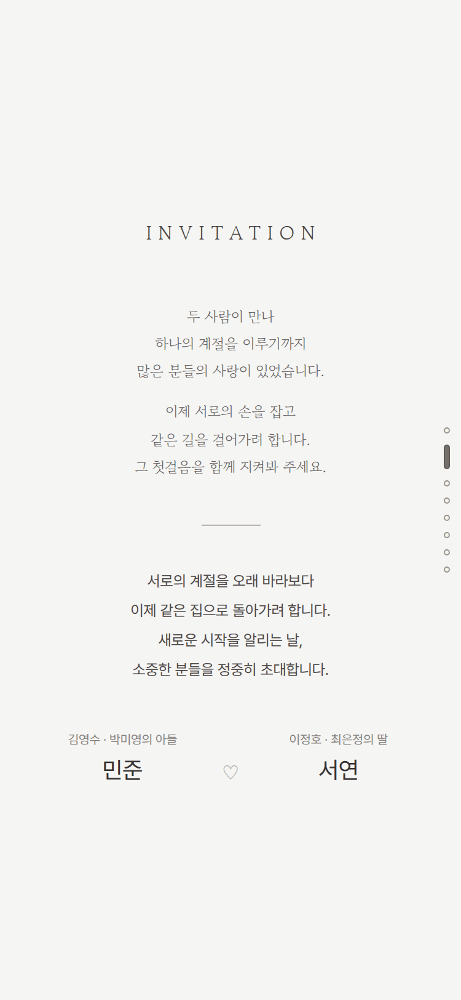
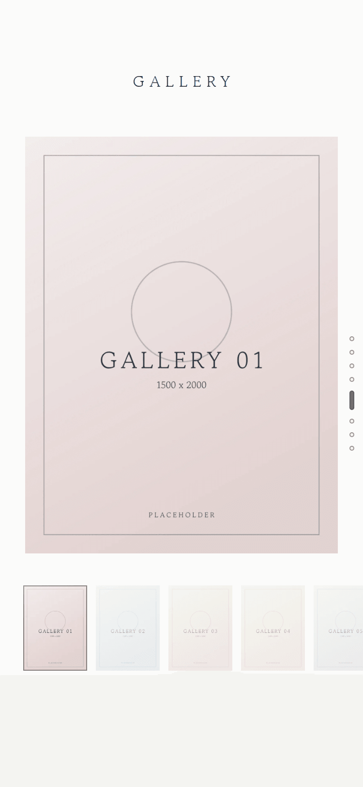
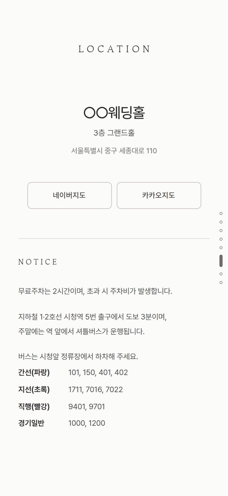
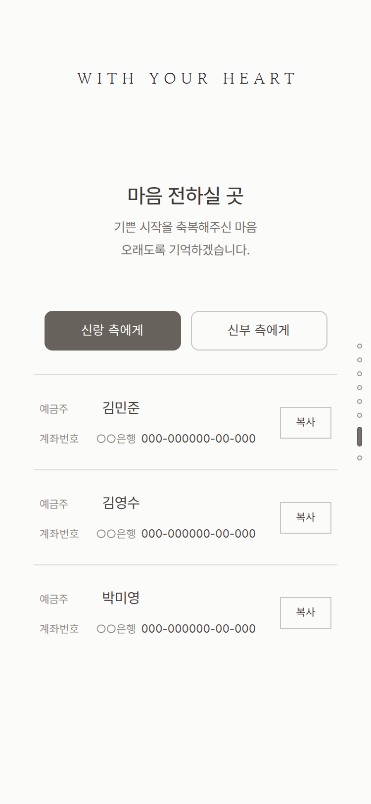

# 모바일 청첩장 템플릿

한 장면씩 스크롤로 넘겨 보는 릴스형 모바일 청첩장입니다.
프레임워크·애니메이션 라이브러리 없이 **Vite + TypeScript** 만 쓰고, 바꿔야 할 정보는 **`src/data/wedding.ts` 한 파일**에 모여 있습니다.
저장소의 이름·사진·계좌는 전부 자리표시자(placeholder)입니다 — 복제해서 본인 정보로 바꾸고 정적 호스팅에 올리면 됩니다.

> **English** — A single-page, reel-style mobile wedding invitation built with Vite + TypeScript and no framework.
> Every editable value lives in `src/data/wedding.ts`; photos, names and bank accounts in this repo are placeholders.
> Run `npm install && npm run dev`, edit `wedding.ts`, drop your photos in `public/images/`, then `npm run check` and deploy `dist/` to any static host.

<p>
  
  
  
  
  
  
</p>

스크린샷은 자리표시 이미지와 가상의 이름으로 찍은 것입니다 (`scripts/screenshots.mjs`).

## 특징

- **데이터 한 곳** — 이름·일시·장소·교통 안내·계좌·사진·공유 문구가 `src/data/wedding.ts` 에 있고, OG 메타 태그까지 같은 값으로 빌드됩니다.
- **의존성 없음** — 런타임 라이브러리 0개. 빌드 결과는 HTML 1장 + CSS·JS 각 1개 + 글꼴 2개 + 사진입니다. 외부 요청(글꼴 CDN·API)이 없습니다.
- **사진은 잘리지 않음** — 프레임이 원본 비율을 따릅니다. 갤러리는 대표 사진 + 썸네일 스트립(탭·쓸기·화살표 키)으로 넘깁니다.
- **지도 앱 바로 열기** — 네이버지도는 앱 스킴으로 열어 보고 안 되면 웹으로, 카카오는 공유 링크로 갑니다.
- **검사 스크립트** — 글꼴 서브셋에 빠진 글자, 참조되지 않는 사진, 깨진 경로, 지도 링크 분기를 `npm run check` 가 잡습니다. 검사에 실패한 커밋은 배포되지 않게 할 수 있습니다.
- **접근성·성능** — 표지만 preload, 나머지는 lazy. `prefers-reduced-motion` 지원, 스킵 링크, 씬 레일 키보드 이동. 자동재생 음악·패럴랙스는 일부러 뺐습니다.

## 시작하기

```bash
git clone https://github.com/PJunhyuk/mobile-wedding-invitation.git my-invitation
cd my-invitation
npm install
npm run dev        # http://localhost:5173
```

Node 22.16 이상이 필요합니다 (브라우저 검사는 Chromium 이 따로 필요, 아래 참고).

## 내 정보로 바꾸기

1. **`src/data/wedding.ts`** — 위에서부터 차례로 채웁니다. 값은 빌드된 자바스크립트에 그대로 공개되므로 공개해도 되는 정보만 넣으세요.
   - `groom` / `bride` — 이름·영문 이름·혼주. 혼주 성함을 비우면 그 줄이 숨겨집니다.
   - `accounts` — `number` 가 빈 행은 숨겨지고, 한쪽이 전부 비면 그 측이, 전부 비면 섹션 자체가 숨겨집니다.
   - `ceremony.start` — ISO 8601 + 오프셋(`+09:00`). 날짜·달력·D-day 가 여기서 나옵니다.
   - `venue` — 이름·홀·주소·전화·좌표. `map.naverPlaceId` 는 네이버 공유 링크가 리디렉션하는 주소의 `pinId` 입니다 (아래 '네이버지도 버튼'). 비워 두면 검색 화면으로만 갑니다. `map.kakao` 는 카카오맵 공유 링크, 비우면 장소명 검색입니다.
   - `locationNotice` — 오시는 길 NOTICE 의 유일한 원본. 예식장 공식 안내를 그대로 옮기고, 확인되지 않은 값은 쓰지 않습니다.
   - `invitation` — 인용문(`stanzas`, 명조체)과 초대 문구(`message`). 저작권이 살아 있는 시를 넣을 때는 인용 범위와 출처 표기를 확인하세요. `author`·`title` 을 비우면 출처 줄이 숨겨집니다.
   - `share` — 카카오톡 등 링크 미리보기의 제목·설명·**배포 URL**. 공유하기·링크 복사 버튼도 이 URL 을 내보냅니다.
2. **사진** — `public/images/` 의 `placeholder-*.webp` 를 지우고 실제 사진(webp 권장, 3:4 세로 1500×2000 기준)을 넣은 뒤 `photos` 의 파일명·alt 를 바꿉니다. 크기가 다르면 `img()` 에 가로·세로를 넘기세요. 그다음 `npm run thumbs` (썸네일) 와 `npm run og` (공유 이미지) 를 실행합니다. 참조되지 않는 파일이 남아 있으면 `npm run check` 가 잡습니다.
3. **글꼴** — 기본 서브셋은 KS X 1001 한글 2,350자를 담고 있어 흔한 이름·문구는 그대로 나옵니다. 드문 한자·옛한글·특수기호를 썼다면 아래 '글꼴' 대로 서브셋을 다시 만드세요. `npm run check` 가 빠진 글자를 알려 줍니다.
4. **`index.html`** — 방문 집계 스크립트를 넣으려면 끝의 주석 자리에 넣습니다. 계좌번호와 혼주 성함이 있으므로 `robots` 메타와 `public/_headers` 의 `X-Robots-Tag` 는 그대로 두는 것을 권합니다.
5. **파비콘** — `public/favicon.svg`, `public/apple-touch-icon.png`.
6. **배포 설정** — `wrangler.jsonc` 의 Worker 이름(Cloudflare 를 쓸 때), `package.json` 의 `name`.
7. `npm run check` 가 통과하면 배포합니다.

## 명령

```bash
npm run dev          # 개발 서버
npm run build        # dist/ 생성
npm run preview      # 빌드 결과 미리보기 (http://localhost:4173)
npm run check        # typecheck + lint + check:content + check:maps + build — 푸시 전에 꼭
npm run thumbs       # public/images/thumbs/ 썸네일 재생성 (사진 추가·교체 시)
npm run og           # public/og.jpg (1200×630) 재생성 (표지 교체 시)
npm run placeholders # placeholder-* 자리표시 이미지 재생성 (wedding.ts 의 크기대로)
npm run fonts -- [--broad] <PretendardVariable.woff2> <GowunBatang-Regular.ttf>   # 글꼴 서브셋 재생성
npm run check:content  # 글자의 글꼴 커버리지·사진 파일 존재·경로 검사 (check 에 포함)
npm run check:maps     # 지도 링크 주소와 네이버지도 버튼 분기 검사 (check 에 포함)
npm run check:photos   # 사진 프레임·확대 방지 브라우저 검사 (preview 서버 필요)
npm run check:fonts    # 글자마다 CSS 가 고른 글꼴의 서브셋에 그 글자가 있는지 브라우저 검사 (preview 서버 필요)
npm run check:live     # 배포된 사이트의 HTML·assets·공유 이미지가 살아 있는지 (node scripts/check-live.mjs <url>)
```

### 브라우저 검사

`check:photos`·`check:fonts`·`scripts/screenshots.mjs`·`scripts/measure-images.mjs` 는 `npm run preview` 로 띄운 빌드를 Chromium 으로 엽니다.
`playwright-core` 는 브라우저를 내려받지 않으므로 실행 파일이 따로 있어야 합니다 (`scripts/lib/browser.mjs`).

```bash
PLAYWRIGHT_CHROME=<chrome 경로>   # 기본값: ~/.cache/ms-playwright/chromium-1187
PREVIEW_URL=<주소>                # 기본값: http://localhost:4173/
```

## 글꼴

본문 Pretendard Variable, 표제·인용문 Gowun Batang 을 서브셋으로 직접 올려 씁니다 (외부 글꼴 요청 없음, 둘 다 OFL — `src/fonts/README.md`).

- **저장소의 기본 서브셋** 은 `--broad` 로 만든 것입니다: 화면 글자 + KS X 1001 한글 2,350자. 합쳐서 약 500KB 이고, 문구를 바꿔도 대개 다시 만들 필요가 없습니다.
- **최소 서브셋** 은 화면에 실제로 나오는 글자만 담아 합쳐서 수십 KB 입니다. 문구가 확정된 뒤 한 번 만들면 됩니다:
  ```bash
  npm run fonts -- <PretendardVariable.woff2 원본> <GowunBatang-Regular.ttf 원본>
  ```
  원본은 [Pretendard 릴리스](https://github.com/orioncactus/pretendard/releases) 의 `web/variable/woff2/PretendardVariable.woff2` 와 [google/fonts](https://github.com/google/fonts/tree/main/ofl/gowunbatang) 의 `GowunBatang-Regular.ttf` 입니다. 최소 서브셋을 쓰면 **문구를 바꿀 때마다 다시 만들어야** 합니다 — 빠진 글자는 시스템 글꼴로 대체되어 티가 나고, `npm run check` 가 실패합니다.
- 필요한 글자는 `scripts/lib/site-text.mjs` 가 소스의 문자열·템플릿 리터럴에서만 모읍니다 (주석·식별자는 후보에 들어오지 않습니다). 검사(`check:content`)는 생성기와 달리 `renderApp()` 이 실제로 만든 마크업에서 글자를 뽑아 대조하므로, 수집기가 글자를 놓쳐도 검사가 잡아냅니다.
- Gowun Batang 은 명조로 조판되는 글자(영문 표제·숫자·초대의 글)만 담습니다. 다른 한글을 명조로 바꾸려면(`styles.css` 의 `var(--serif)`) `serifChars` 에 더하세요. `check:fonts` 가 빠진 글자를 잡습니다.

## 구조

```
index.html               셸 + 메타 태그 ({{token}}은 wedding.ts 값으로 치환)
src/data/wedding.ts      ★ 중앙 데이터 — 바꿀 것은 전부 여기
src/main.ts              부팅, 씬 레일, 갤러리 선택(썸네일·쓸기)·공유·계좌 인터랙션
src/render.ts            데이터 → 섹션 마크업
src/styles.css           디자인 토큰과 섹션 스타일 (장면 순서대로, 셀렉터마다 규칙 하나 + 장면별 낮은 화면 보정)
src/lib/date.ts          KST 기준 날짜 포맷, 달력 그리드, D-day 문구
src/lib/maps.ts          네이버·카카오 지도 링크, 네이버지도 앱 열기
src/lib/dom.ts           html 태그드 템플릿(자동 이스케이프), $/$$, toast, copyText
src/fonts/               Pretendard·Gowun Batang 서브셋 + OFL 고지 (빌드가 해시를 붙임)
public/images/*.webp     사진 (지금은 자리표시 이미지)
public/images/thumbs/    갤러리 썸네일 320px (scripts/thumbs.mjs)
public/og.jpg            공유용 이미지 (scripts/make-og.mjs, 표지와 같은 컷)
public/favicon.svg       파비콘 — 눈 내리는 밤. apple-touch-icon.png(180px)는 같은 그림의 iOS 홈 화면용
public/_headers          보안·캐시 헤더 (Cloudflare·Netlify 형식)
wrangler.jsonc           Cloudflare Workers 배포 설정 (쓰지 않으면 지워도 됩니다)
scripts/check-*.mjs      검사 스크립트 (content·maps 는 check 에 포함, photo-*·fonts 는 브라우저 검사, live 는 배포 감시)
scripts/placeholders.mjs 자리표시 이미지 생성
scripts/lib/source.mjs   검사 스크립트가 .ts 소스를 vite 로 읽는 헬퍼 (Node 버전과 무관하게)
.github/workflows/       check (푸시마다 npm run check)
docs/screenshots/        README 용 스크린샷 (scripts/screenshots.mjs)
```

## 장면 구성

표지 → 초대의 글 → 대표 사진 → 예식일(날짜·달력·D-day) → 갤러리 → 오시는 길 → 마음 전하실 곳 → 맺음말.
각 장면은 화면 높이 한 페이지이고, 우측 씬 레일 점으로 현재 위치 표시·바로 이동이 됩니다.
`index.html` 의 OG/메타 태그와 표지 사진 preload 도 같은 데이터로 빌드 시 만들어집니다 (`vite.config.ts` 의 `htmlData` 플러그인). 대응하는 값이 없는 `{{토큰}}` 은 빌드를 세웁니다.

## 배포

빌드 결과(`dist/`)는 정적 파일이라 어느 호스팅에나 올릴 수 있습니다. 두 가지만 지키면 됩니다.

- **없는 주소도 청첩장으로** — 서버가 `/foo/` 같은 경로에도 `index.html` 을 돌려주게 합니다 (SPA fallback). 그래서 자산·사진 경로는 `/` 로 시작하는 절대 경로입니다 (`vite.config.ts` 의 `base: '/'`). 상대 경로로 바꾸면 그런 주소에서 빈 화면이 됩니다 (`check:content` 가 검사).
- **HTTPS** — http:// 로 열리면 공유·복사 API 가 동작하지 않습니다.

### Cloudflare Workers (저장소에 설정이 들어 있음)

`wrangler.jsonc` 는 스크립트 없이 `dist/` 의 정적 자산만 올리는 Worker 입니다. 정적 자산 요청은 Workers 의 요청 한도에 들어가지 않으므로 공유가 몰려도 한도에 걸리지 않습니다.

1. Cloudflare 대시보드 → Workers & Pages → 저장소 연결 (Workers Builds).
2. **Build command 를 `npm run check`** 로, Deploy command 를 `npx wrangler deploy` 로 둡니다. 검사에 실패한 커밋은 배포되지 않고 직전 배포가 그대로 남습니다.
3. 도메인을 연결하고 SSL/TLS → Edge Certificates → *Always Use HTTPS* 를 켭니다.
4. `wrangler` 는 `package.json` 에 정확한 버전으로 고정되어 있어 Cloudflare 가 새 릴리스를 내도 배포 방식이 바뀌지 않습니다. 올릴 때는 `npm i -D -E wrangler@<버전>` 후 `npx wrangler deploy --dry-run` 이 통과하는지 보고 푸시합니다.

빌드 명령에 들어가는 스크립트는 `.ts` 를 직접 import 하지 않고 `scripts/lib/source.mjs` 의 `loadSource` 로 읽습니다 — 빌드 환경의 Node 가 `.ts` 를 못 읽는 버전(22.18 미만)이어도 빌드가 서지 않게 하기 위해서이고, GitHub Actions(`check`)가 Node 22.16 에서도 돌려 확인합니다.

### 다른 정적 호스팅

Netlify·Vercel·GitHub Pages 등에 `dist/` 를 올립니다. `public/_headers` 는 Netlify 도 같은 형식으로 읽습니다. SPA fallback 설정은 호스팅별 문서를 보세요.

### 예식 전 운영 메모

- 예식 전에는 꼭 필요한 변경만 푸시합니다. 잘못 올라갔으면 호스팅의 이전 배포로 Rollback 하는 것이 가장 빠릅니다. 배포한 커밋에는 `deploy-YYYYMMDD` 같은 태그를 붙여 두면 찾기 쉽습니다.
- **살아 있는지 감시** — `node scripts/check-live.mjs <url>` 이 HTML·CSS·JS·글꼴·공유 이미지가 실제로 오는지, `EXPECTED_SHA` 를 주면 그 커밋이 배포되었는지(페이지 소스의 `<meta name="build">`) 확인합니다. GitHub Actions 로 매시간 돌리려면 아래 워크플로를 `.github/workflows/live.yml` 로 추가하세요 (실패하면 GitHub 이 메일을 보냅니다). 더 촘촘히 보려면 UptimeRobot 같은 무료 모니터에 5분 간격으로 등록하세요.
  ```yaml
  name: live
  on:
    schedule: [{ cron: '17 * * * *' }]
    workflow_dispatch:
  jobs:
    live:
      runs-on: ubuntu-latest
      steps:
        - uses: actions/checkout@v4
        - uses: actions/setup-node@v4
          with: { node-version: 24 }
        - run: node scripts/check-live.mjs
          env: { EXPECTED_SHA: '${{ github.sha }}' }
  ```
- **카카오톡 미리보기 캐시** — 카카오톡은 미리보기를 주소 단위로 캐시하므로, `share` 의 title/description/ogImage 를 바꾼 뒤에는 [카카오 공유 디버거](https://developers.kakao.com/tool/debugger/sharing)에서 배포 URL 의 캐시를 초기화해야 새 미리보기가 나옵니다.
- 도메인 만료일이 예식일 뒤인지, 호스팅 계정 결제 수단에 문제가 없는지 미리 확인해 둡니다.

## 네이버지도 버튼

공유 링크(`naver.me`)는 모바일에서 중간 페이지를 거쳐 앱을 띄웁니다.
버튼은 그 단계를 거치지 않고 직접 앱을 열어 보고, 안 되면 웹의 장소 화면으로 갑니다 (`src/lib/maps.ts`).

- **PC** — 웹 장소 화면(`map.naver.com/p/entry/place/<ID>`)으로 가는 보통 링크입니다.
- **Android** — `intent://` 주소로 앱을 엽니다. 앱이 없으면 브라우저가 웹 장소 화면으로 보냅니다.
- **iPhone·iPad** — `navermaps://` 스킴으로 앱을 엽니다. 1.8초 뒤에도 페이지가 그대로 보이면 웹 장소 화면으로 갑니다.
  페이지가 가려지거나 포커스를 잃으면 앱이 열린 것으로 보고 웹으로 가지 않습니다. 그래서 "앱에서 열겠습니까?" 대화상자를 취소한 뒤에는 버튼을 다시 눌러야 할 수 있습니다.
- 앱 주소 형식은 문서가 아니라 네이버 공유 링크가 모바일에서 실제로 쓰는 코드에서 확인한 것입니다 (2026-09 기준, 공식 URL scheme 문서는 403). 네이버가 형식을 바꾸면 웹 화면으로 가는 쪽만 남습니다.
- **장소 ID 얻기** — 네이버지도 앱·웹에서 장소를 열고 공유 > 링크 복사로 얻은 `naver.me/…` 주소를 브라우저에서 열면 `…?pinId=<숫자>` 또는 `/place/<숫자>` 로 리디렉션됩니다. 그 숫자가 `venue.map.naverPlaceId` 입니다.
- `npm run check:maps` 는 주소와 분기·취소 조건을 가짜 브라우저 환경에서 검사합니다. **실제로 앱이 열리는지는 실기기(앱 설치·미설치, 카카오톡 인앱 브라우저)에서만 확인할 수 있습니다.**

## 편집 규칙

- 갤러리는 대표 사진 한 장과 아래 가로 썸네일 스트립입니다. 썸네일을 누르거나, 대표 사진을 옆으로 쓸거나, 갤러리 안에서 좌우 화살표 키를 누르면 사진이 바뀝니다. 확대 뷰어는 없습니다.
- 사진은 잘라 내지 않고 원본 비율 그대로 보여 주므로, 구도는 파일을 크롭해서 맞춥니다. 파일명은 한번 정하면 바꾸지 않는 것을 권합니다 (예: `<가져온 날짜>-<원본 id>-<원본 sha256 앞 8자>.webp`). 역할·순서는 파일명이 아니라 `photos` 배열이 정합니다.
- D-day 문구는 KST 달력일 기준 3단계입니다: 'N일 남았습니다' / '오늘입니다' / 예식 후 감사 인사.
- 공유하기·링크 복사는 둘 다 쿼리·해시를 뗀 `share.url` 을 내보냅니다.

## 접근성·성능

- 사진은 width/height 를 지정해 자리를 먼저 잡습니다. 표지만 preload + 높은 우선순위로 받고, 대표 사진과 갤러리 첫 장은 바로, 썸네일과 맺음말 사진은 가까워졌을 때(lazy) 받습니다.
- 갤러리에서 고른 사진은 원본을 바로 띄웁니다. 갤러리가 한 화면 앞으로 다가오면 현재 사진과 앞뒤 사진만 낮은 우선순위로 미리 받아 둡니다 (표지를 다 받은 뒤에 시작). 수치는 `node scripts/measure-images.mjs` 로 잽니다.
- `prefers-reduced-motion`: 장면 등장 모션과 부드러운 스크롤이 꺼지고 완성된 상태로 바로 표시됩니다.
- 갤러리는 감상 전용: 우클릭·드래그 저장 메뉴를 노출하지 않습니다. 확대는 사진 영역에서만 막습니다 (`data-photo-no-zoom`: 핀치·더블탭). 페이지 전체의 확대는 막지 않으므로 글씨는 키워 볼 수 있습니다.
- 계좌번호와 혼주 성함이 있으므로 검색에 노출되지 않게 합니다 (`robots` 메타 + `X-Robots-Tag` 헤더). 카카오톡 등의 링크 미리보기에는 영향이 없습니다.

## 라이선스

코드는 [MIT](LICENSE) 입니다. 글꼴(Pretendard, Gowun Batang)은 SIL OFL 1.1 이며 고지문이 `src/fonts/` 에 있습니다.
저장소의 자리표시 이미지는 `scripts/placeholders.mjs` 가 만든 것으로 자유롭게 바꿔 쓰면 됩니다.
